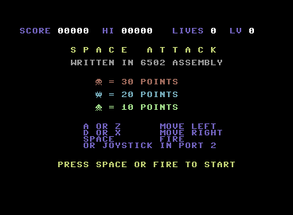
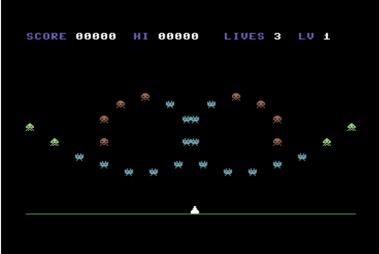
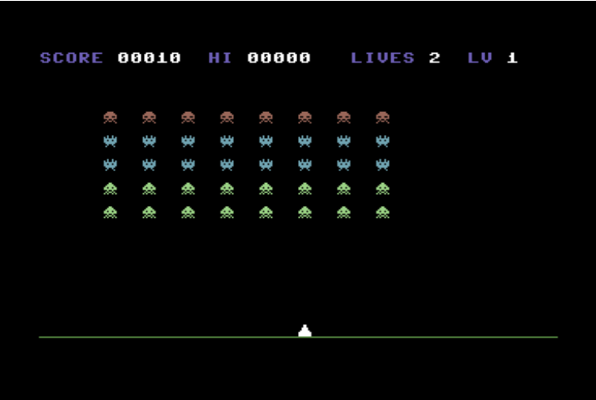

# C64_Space_Invaders
C64 Space Invader for learning how to program games with graphics in MOS 6510 (6502) Assember

Play online by loading the .prg into the emulator:
https://c64online.com/c64-online-emulator/

Click on the folder icon to load the game.
When the upload dialog appears, select the .prg file: spaceattack.prg

Enjoy!

After the game is loaded and ready to start:

The aliens fly in from left and right:

After the aliens are ready:

