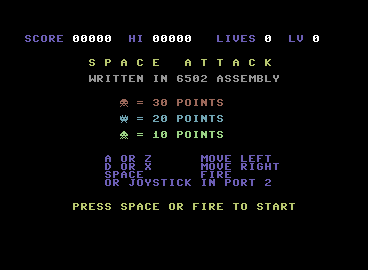
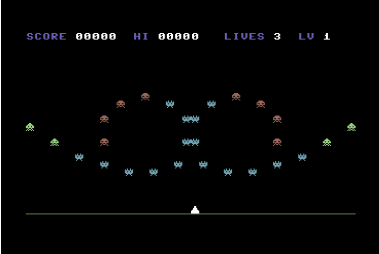
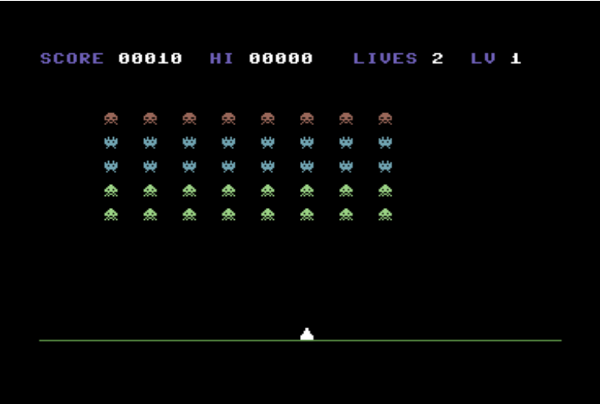

# C64 Space Invaders INCLUDING the assembler code the game is made from
C64 Space Invader for learning how to program games with graphics in MOS 6510 (6502) Assembler.

Commodore 64 Space Invaders assembler code for self study.

#### Test in your browser first?

<a href="https://github.com/gardengnomethatlookslikeafrog/C64_Space_Invaders/blob/main/spaceattack_WebAssembly.html">Play!</a>

#### Play online by loading the .prg into the emulator:

https://c64online.com/c64-online-emulator/

#### Click on the folder icon to load the game.

When the upload dialog appears, select the .prg file: spaceattack.prg

#### After the game is loaded and ready to start:

#### The aliens flies in from left and right:

#### After the aliens are ready:

## Enjoy!
